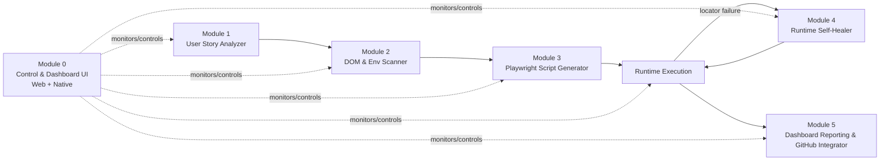

# 🚀 DOMONO — Autonomous End-to-End QA Agent

DOMONO is an autonomous QA engineering pipeline that orchestrates **six functional modules** to take a raw user story all the way to a healed, passing, GitHub-published Playwright test suite — with live cross-platform (Web + Mobile) command dashboards.

## Architecture



## Repository Layout

```
domono/
├── README.md
├── requirements.txt            # Node/tooling prerequisites for the whole pipeline
├── web/                        # Module 0 — Web dashboard (plain React + CSS, no Tailwind)
│   └── src/components/{LandingPage.jsx, DomonoDashboard.jsx, PipelineCard.jsx}
├── mobile/                     # Module 0 — Mobile dashboard (React Native + StyleSheet)
│   └── src/components/{LandingScreen.tsx, DomonoDashboard.tsx, PipelineCard.tsx}
├── integrator/                 # Module 5 — GitHub PR publisher + PAT mail notifier
│   ├── .env.example
│   ├── run.js
│   └── lib/{githubIntegrator.js, mailNotifier.js, reportGenerator.js}
├── schemas/                    # JSON contracts for Modules 1, 2, 4
│   ├── user-story-analyzer.schema.json
│   ├── dom-scanner.schema.json
│   └── self-healer.schema.json
├── specs/                      # Module 3 — Example generated Playwright spec
│   └── example.spec.ts
└── reports/                    # Module 5 — Example generated dashboard report
    └── example-report.md
```

## Separate, Independently Runnable Pipelines

Both dashboards render **six independent pipeline cards** — one per DOMONO module — instead of a single combined flow. Each card (`PipelineCard.jsx` on web, `PipelineCard.tsx` on mobile) has its own Run/Stop controls, status badge (`queued` / `running` / `passed` / `failed` / `healed`), and live log stream, so any module can be started, stopped, or re-run without affecting the others:

1. 📝 User Story Analyzer
2. 🔍 DOM & Env Scanner
3. 🧩 Playwright Generator
4. ⚙️ Test Execution
5. 🩹 Runtime Self-Healer
6. 📊 Reporting & GitHub

## Modules

| # | Module | Input | Output |
|---|--------|-------|--------|
| 0 | Control & Dashboard Interfaces | n/a | `web/` React component, `mobile/` React Native component |
| 1 | User Story Analyzer | Raw story / JIRA ticket / prompt | Strict JSON test requirements (`schemas/user-story-analyzer.schema.json`) |
| 2 | DOM & Environment Scanner | DOM snapshot / a11y tree | Strict JSON locator map (`schemas/dom-scanner.schema.json`) |
| 3 | Playwright Script Generator | Test cases + locator map | Executable TypeScript spec (`specs/example.spec.ts`) |
| 4 | Runtime Self-Healer | Failed locator + live DOM | Strict JSON patch (`schemas/self-healer.schema.json`) |
| 5 | Dashboard Reporting & GitHub Integrator | Execution results + healing log | Markdown report (`reports/example-report.md`) + PR description |

## Getting Started

### Prerequisites
See [requirements.txt](requirements.txt) for the full tooling list. In short, you need **Node.js ≥ 18** and **npm**.

### Web Dashboard
Plain React + plain CSS (`src/index.css`) — no Tailwind or other CSS framework.
```bash
cd web
npm install
npm run dev
```

### Mobile Dashboard (Expo / React Native)
```bash
cd mobile
npm install
npx expo start
```

### Playwright Specs
```bash
npm install -D @playwright/test
npx playwright install
npx playwright test specs/example.spec.ts
```

## GitHub Integration Workflow (Module 5)

1. DOMONO generates/heals specs on branch `domono/qa-automation-suite`.
2. A structured commit is created: `feat(qa): auto-generated Playwright specs and healed locators for {story_id}`.
3. A PR is opened targeting `main` with the auto-generated report body (see [reports/example-report.md](reports/example-report.md)).
4. Notifications (PAT-authenticated mail) are dispatched on pipeline completion/failure for helpdesk-style alerting, per team convention.

### Running the integrator
```bash
cd integrator
npm install
cp .env.example .env   # fill in GITHUB_TOKEN, SMTP_PAT, etc.
npm start
```
`npm start` renders the Module 5 report, opens a GitHub PR via `@octokit/rest` + `simple-git` (if `GITHUB_TOKEN` is set), and sends a PAT-authenticated email via `nodemailer` (if `SMTP_PAT` is set). Both steps are skipped gracefully when their credentials are absent.

## Status Legend (used across dashboards)

| Status | Meaning |
|--------|---------|
| 🟢 `passed` | Test executed and assertions succeeded |
| 🔴 `failed` | Test executed and assertions failed, no healing applied |
| 🩹 `healed` | Locator failure intercepted and repaired by Module 4 |
| ⏳ `running` | Test currently executing |
| ⚪ `queued` | Test pending execution |
